# The Polson factory: ticket to main

How one ticket becomes a commit on `main`, as the repo works on 2026-11-23. Every node is checked against `.github/workflows/polson-agent.yml`, the scripts in `.github/polson/`, `AGENTS.md` and the `protect-main` ruleset. Nothing here is aspirational unless it is marked PLANNED.

**Status marks**

- **USED**: it has happened on a real ticket. The issue, PR or run number is the proof.
- **BUILT**: it is in the workflow or scripts, but no real run has needed it yet.
- **PLANNED**: it is not built.

## Diagram

```mermaid
flowchart TD
  T["Ticket: GitHub issue with acceptance criteria<br/>USED: #23"]
  INV["Investigate: a person runs Qodo Codebase Wisdom<br/>USED: #16"]
  RT{"A person routes it: does the work<br/>need edits under .github/?<br/>USED: #16 split into #17 agent, #18 person"}
  T --> INV --> RT

  subgraph PERSON["Person path: interactive Claude Code"]
    P1["Implement, uncommitted<br/>USED: PR #20"]
    P2["Qodo local review of staged and unstaged changes<br/>USED: PR #20"]
    P3{"Valid High or Medium?"}
    P4["Commit, push, open the PR<br/>USED: PR #20"]
    PW["Wait for CI and Qodo's review of the head commit,<br/>apply the quality gate by hand<br/>USED: PR #20, PR #24"]
    P1 --> P2 --> P3
    P3 -- "yes: fix" --> P1
    P3 -- "no" --> P4 --> PW
  end
  RT -- "yes" --> P1

  subgraph START["Agent run start: polson-agent.yml, one job at a time"]
    L["A person adds ready-for-agent<br/>USED: #23"]
    NT["Nightly 01:17 UTC, 02:17 Lagos:<br/>oldest open ready-for-agent issue<br/>trigger USED: run 45000874965, nothing to pick"]
    WD["Manual run: workflow_dispatch<br/>BUILT"]
    SW["Hand over issues an earlier run left in agent-working<br/>BUILT"]
    CK{"Issue open and still<br/>labelled ready-for-agent?"}
    MK["Swap to agent-working, clear an old<br/>needs-human or agent-done<br/>USED: #23"]
    L --> SW
    NT --> SW
    WD --> SW
    SW --> CK
    CK -- "yes" --> MK
  end
  RT -- "no" --> L
  CK -- "no" --> NOP["Nothing to do, no label change<br/>USED: run 45000874965"]

  RC{"Resume check: open PRs from<br/>branches named issue-slug?"}
  MK --> RC
  B["Build agent: implement, typecheck, tests,<br/>push-branch.sh, PR with Closes # and the criteria<br/>USED: #17 PR #19, #23 PR #24"]
  AB{"After build: agent step succeeded<br/>and exactly one agent PR exists?<br/>USED: #23"}
  RC -- "none<br/>USED: #23" --> B --> AB

  CI["Required CI on every push: Node 24, Node 20.19.0<br/>USED: every PR"]
  WT["Scripted wait, wait-for-pr.sh: every 60 s, up to 15 min.<br/>CI finished on the head commit, Qodo's review names it,<br/>the fail-closed reader gives a number, no busy comment,<br/>2 polls agree. Qodo's review record: a complete,<br/>non-skipped run on the head commit (BUILT, #26).<br/>USED: #23 PR #24"]
  RC -- "one agent PR: resume<br/>USED: #9 PR #11" --> WT
  AB -- "yes" --> WT
  CI -.-> WT
  CI -.-> PW

  WG{"Wait gate: PR open,<br/>CI and Qodo finished?"}
  WT --> WG
  RS["Resolve agent, applies the quality gate:<br/>fix valid High or Medium, disagree with evidence,<br/>list Low, push at most once, Round report<br/>USED: #9 round 1, #17 rounds 1 and 2"]
  WG -- "yes, before round 1 or 2" --> RS
  AR{"After resolve: did it push?"}
  RS --> AR
  AR -- "yes: wait again<br/>USED: #17 2a7009c" --> WT
  AR -- "no<br/>USED: #9, #17" --> FN
  WG -- "yes, after round 2<br/>BUILT" --> FN

  FN{"Finish: PR head unchanged, CI green,<br/>Qodo finished, 0 open High or Medium?"}
  AD["agent-done, with a summary comment<br/>USED: #9, #17"]
  NH["needs-human: comment first, then label<br/>USED: #9, #23"]
  FN -- "yes" --> AD
  FN -- "no<br/>BUILT" --> NH
  WG -- "no: not finished in 15 min, unreadable review,<br/>PR not open, branch moved<br/>USED: #9, #23" --> NH
  RC -- "a PR not opened by the agent,<br/>or more than one<br/>BUILT, tested in find-pr.test.ts" --> NH
  AB -- "no<br/>BUILT" --> NH
  AGE["The agent escalates itself: unclear criteria,<br/>needs .github/, cannot fix within the rules<br/>BUILT"] --> NH
  HO["A step fails or times out: hand-over step<br/>BUILT"] --> NH

  subgraph HUMAN["A person decides"]
    HD["Review the PR against the quality gate.<br/>Dismiss a finding in Qodo: USED PR #12, an accepted risk.<br/>Accept an exception in writing: USED PR #12, PR #21.<br/>Take over an escalated ticket: USED #23 PR #24.<br/>Relabel to retry: USED #9."]
  end
  AD --> HD
  NH --> HD
  PW --> HD
  HD -- "relabel" --> L

  MG["A person merges with gh pr merge.<br/>protect-main: a PR and both CI checks,<br/>no force push or deletion, no bypass<br/>USED: PR #11, PR #19, PR #24"]
  HD -- "gate met" --> MG --> MAIN["main"]

  INVA["Codebase Wisdom inside the agent run<br/>PLANNED"]
  LRA["Qodo local review inside the agent run<br/>PLANNED"]
  PH["Protected path: .github/ changes need<br/>human review on GitHub. PLANNED: Day 14"]
  NR["Night record and morning report from each run<br/>PLANNED: code in src/, not run by the workflow"]
  INVA -.-> B
  LRA -.-> B
  PH -.-> MG
  AD -.-> NR
  NH -.-> NR

  classDef used fill:#d8f0dc,stroke:#2e7d32,color:#111
  classDef built fill:#fff4cc,stroke:#b58900,color:#111
  classDef planned fill:#eeeeee,stroke:#888,stroke-dasharray:4 3,color:#444
  class T,INV,RT,P1,P2,P4,PW,L,NT,MK,NOP,B,AB,CI,WT,RS,AD,NH,HD,MG used
  class WD,SW,AGE,HO built
  class INVA,LRA,PH,NR planned
```

## Gates

Each gate says what must pass, the evidence it uses, what happens on failure, and who decides.

### 1. Routing

| | |
|---|---|
| Must pass | The issue has acceptance criteria. Work that needs `.github/` edits goes to a person, not the agent. |
| Evidence | The issue text, read by a person. Nothing checks this automatically. |
| On failure | The build or resolve agent escalates when it finds it needs `.github/` (its prompt says so, and `Edit(./.github/**)` and `Write(./.github/**)` are denied). |
| Who decides | A person, when writing and labelling the ticket. |

### 2. Start of a run

| | |
|---|---|
| Must pass | The label was added by a user, not a bot. The issue is open, is not a PR, and still has `ready-for-agent`. No other agent job is running. |
| Evidence | The event, then a fresh read of the issue (`polson-agent.yml`, "Resolve the issue number"). |
| On failure | "Nothing to do"; no label changes. A queued run replaced by a newer one never starts, so its issue keeps `ready-for-agent` for the nightly run. |
| Who decides | The workflow. |

### 3. Resume check and after build (`phase.sh find-pr`, `after-build`)

| | |
|---|---|
| Must pass | Resume check: 0 open PRs from `<issue>-*` branches means build; exactly 1, opened by the agent, means resume. After build: the agent step succeeded and exactly 1 agent PR exists. |
| Evidence | `gh pr list`, counted in jq. A count that can't be read fails the step (`test/find-pr.test.ts`). |
| On failure | `needs-human` for more than one PR, a PR not opened by the agent, no PR after the build, or a failed or skipped agent step. An unreadable list fails the step, and the hand-over step labels the issue. |
| Who decides | The script. |

### 4. Required CI (`ci.yml`)

| | |
|---|---|
| Must pass | `Node 24` and `Node 20.19.0` (`npm ci`, `npm run typecheck`, `npm test`) on the head commit. |
| Evidence | Check runs from the GitHub Actions app (id 15368) only. A same-named check from another app does not count. |
| On failure | Red CI goes to the resolve agent. CI not finished in 15 minutes, or red at finish, means `needs-human`. GitHub refuses the merge. |
| Who decides | The script during the run; the `protect-main` ruleset at merge. |

### 5. Scripted wait (`wait-for-pr.sh`, `qodo-open-findings.sh`)

| | |
|---|---|
| Must pass | All of these on 2 polls in a row with the same count: CI finished on the head commit; Qodo's "Code Review by Qodo" names the head commit; the reader prints a number; no "busy" comment; and Qodo's own review record (read with the Qodo CLI) says the latest run is on the head commit, completed, complete and not skipped (BUILT, #26). The reader prints a number only when the comment has Qodo's footer, every open finding has its own known severity label, and the count badges match the findings listed. Structure is matched only at the start of a line. |
| Evidence | Qodo's review comment, Qodo's review record (`qodo read pr-review-session findings --extended`), and the check runs. |
| On failure | Unknown or unreadable counts as not finished, and so does a skipped Qodo run. After 15 minutes: `needs-human`, with "Qodo skipped reviewing <head>" for a skip. The branch moving after the check also means `needs-human`. |
| Who decides | The script. |

### 6. Resolve (`resolve-prompt.md`, the AGENTS.md quality gate)

| | |
|---|---|
| Must pass | Each CI failure and Qodo finding is reproduced or traced first. Valid High and Medium findings are fixed. Disagreements are answered on the PR with evidence and flagged. Every Low is listed. Typecheck and tests pass. At most one push. Only verified criteria are ticked. There is a "Round N report" on the issue. |
| Evidence | The agent's report, its PR comments, the diff. |
| On failure | The agent escalates (`needs-human`). A round with no push goes straight to finish. After 2 pushed rounds, a last wait, then finish. |
| Who decides | The agent decides what is valid. A person accepts or rejects its disagreements. |

### 7. Finish (`phase.sh finish`)

| | |
|---|---|
| Must pass | The PR is open with the same head commit that was checked, CI succeeded, Qodo finished, and the open High or Medium count is the number 0. |
| Evidence | The latest wait's outputs and a fresh read of the PR. |
| On failure | `needs-human`, with the reason in a comment posted before the label. |
| Who decides | The script. `agent-done` still means "a person decides", not "merge". |

### 8. Human review and merge

| | |
|---|---|
| Must pass | The quality gate's "done": no valid High or Medium open, typecheck and tests pass, the latest Qodo review covers the final code, every Low listed. A disagreed finding is dismissed in Qodo, and an exception is accepted in writing on the PR. |
| Evidence | The PR, Qodo's review, CI, and the agent's report or the person's notes. |
| On failure | No merge. The person relabels to retry, takes the ticket over, or closes it. |
| Who decides | A person. |

### 9. `protect-main` ruleset

| | |
|---|---|
| Must pass | A pull request, plus `Node 24` and `Node 20.19.0` from GitHub Actions. No force push, no branch deletion, no bypass actors. |
| Evidence | GitHub. |
| On failure | GitHub refuses the push or merge. |
| Who decides | GitHub, as configured by the owner. It does not check Qodo, approvals (0 required), or whether the branch is up to date with `main`. |

## Status of every step

| Step | Status | Proof |
|---|---|---|
| Ticket with acceptance criteria | USED | #23 |
| Investigate with Codebase Wisdom (person) | USED | #16 ([comment](https://github.com/shrooms08/polson/issues/16#issuecomment-7078340522)) |
| Route by `.github/` need (person) | USED | #16 split into #17 (agent) and #18 (person) |
| Person path: uncommitted, local Qodo review, fix, commit, PR | USED | PR #20 (#18) |
| Person waits for CI and Qodo, applies the gate by hand | USED | PR #20, PR #24 |
| `ready-for-agent` added by a person | USED | #9, #17, #23 |
| Nightly trigger | USED, but no ticket picked yet | run 45000874965 (scheduled 01:17 UTC, started 08:01 UTC): "Nothing to do" |
| Manual run (`workflow_dispatch`) | BUILT | |
| Hand over issues left in `agent-working` | BUILT | Ran every time, never found one |
| Swap to `agent-working`, clear old outcome labels | USED | #23 |
| Resume check: none, so build | USED | #17, #23 |
| Resume check: one agent PR, so resume | USED | #9 (PR #11, run 45001404177) |
| Resume check: foreign or duplicate PR, so `needs-human` | BUILT | `test/find-pr.test.ts` |
| Build agent and `push-branch.sh` | USED | #17 (PR #19), #23 (PR #24) |
| After build: no PR or a failed agent step, so `needs-human` | BUILT | |
| Required CI | USED | Every PR |
| Scripted wait | USED | #9, #17, #23 |
| Wait gate: not finished, so `needs-human` | USED | #9 ([comment](https://github.com/shrooms08/polson/issues/9#issuecomment-7070095037)), #23 ([comment](https://github.com/shrooms08/polson/issues/23#issuecomment-7084443687)) |
| Resolve round 1 | USED | #9, #17 |
| Resolve round 1 pushed, so wait again | USED | #17 (`2a7009c`) |
| Resolve round 2 | USED | #17 |
| Resolve pushed nothing, so finish | USED | #9, #17 |
| Last wait after round 2 | BUILT | |
| Agent escalates itself | BUILT | Only in the pre-PR #12 workflow (#9, run 44910962909) |
| Finish: `agent-done` | USED | #9, #17 |
| Finish: `needs-human` (CI red, High or Medium left, unreadable, PR changed) | BUILT | |
| Hand-over step after a failed or timed-out step | BUILT | Ran every time, never needed |
| Dismiss a finding in Qodo | USED | PR #12: a High accepted as a risk (#13) |
| Accept a disagreement by dismissing it in Qodo (the quality gate's way) | BUILT (a rule, not yet used) | Not used yet. PR #20's disagreed Medium was merged before the gate existed and is still pending in Qodo. |
| Accept an exception in writing | USED | PR #12 (a Medium, the 150-minute job limit), PR #21 ([comment](https://github.com/shrooms08/polson/pull/21#issuecomment-7084182389)) |
| Take over an escalated ticket | USED | #23 (PR #24) |
| Relabel to retry | USED | #9 |
| Merge by a person through `protect-main` | USED | PR #11, PR #19, PR #24 |
| Codebase Wisdom inside the agent run | PLANNED | |
| Qodo local review inside the agent run | PLANNED | |
| Protected path: `.github/` changes need human review on GitHub | PLANNED | Day 14 |
| Night record and morning report from each run | PLANNED | `src/night-record.ts` and `src/morning-report.ts` exist; no workflow step writes a record |

## Walkthrough: issue #23

[#23](https://github.com/shrooms08/polson/issues/23), "Test the Qodo findings reader on real Qodo comments".

1. **Ticket.** A person wrote it on 2026-11-22 with four acceptance criteria and "must not edit anything under .github/".
2. **Route: agent.** A person added `ready-for-agent` at 19:13:03Z.
3. **Start.** [Run 45059495279](https://github.com/shrooms08/polson/actions/runs/45059495279): no left-behind issues. At 19:13:31Z the label went from `ready-for-agent` to `agent-working`.
4. **Resume check.** No open PR, so build.
5. **Build agent.** It committed `ecced4d` (three fixtures, 10 tests) and opened [PR #24](https://github.com/shrooms08/polson/pull/24) at 19:15:15Z with `Closes #23` and the criteria. It said it could not prove its tests fail first, because the script is under `.github/`.
6. **After build.** One agent PR, so wait.
7. **Required CI** on `ecced4d`: [run 45059698651](https://github.com/shrooms08/polson/actions/runs/45059698651), green on both Node versions.
8. **Qodo** reviewed `ecced4d` at 19:17:11Z (lite effort): 2 Medium findings.
9. **Scripted wait.** 15 polls, 19:15 to 19:29. From poll 3 the review named the head commit, but the reader printed `unknown` every time: it took text Qodo had quoted inside a finding for real structure.
10. **Wait gate: `needs-human`.** [Escalation comment](https://github.com/shrooms08/polson/issues/23#issuecomment-7084443687): "Qodo did not finish reviewing ecced4d within 15 minutes". The resolve agent never ran.
11. **A person steps in: diagnosis.** Read-only, nothing posted. Qodo had finished; the reader misread it.
12. **A person steps in: fix.** [`c012d32`](https://github.com/shrooms08/polson/commit/c012d32dd221e3ceea7d80ea77c6d9f05afcf3d5). The reader matches structure only at line start, requires the footer, and treats an unlabelled finding as `unknown`. Seven new tests failed on the old script and pass on the new one. Also closes #22. Replies on finding [1](https://github.com/shrooms08/polson/pull/24#issuecomment-7086699602) and [2](https://github.com/shrooms08/polson/pull/24#issuecomment-7086700276).
13. **Required CI** on `c012d32`: [run 45076742789](https://github.com/shrooms08/polson/actions/runs/45076742789), green.
14. **Qodo** reviewed `c012d32` (standard effort): finding 2 resolved, finding 1 still open.
15. **A person runs the wait script read-only:** `qodo=finished open_high_medium=1`. The reader now gives a number.
16. **A person applies the gate.** Finding 1 does not reproduce on `c012d32`, so the person did not change code. Fix round 1, [`d3fd88b`](https://github.com/shrooms08/polson/commit/d3fd88bfb60e920e93de72d8500b57a7b347e7ab), adds a test that cuts each fixture at every line before the footer, with [evidence on the PR](https://github.com/shrooms08/polson/pull/24#issuecomment-7086791018).
17. **Required CI** on `d3fd88b`: [run 45077518880](https://github.com/shrooms08/polson/actions/runs/45077518880), green. **Qodo** (lite effort): both findings resolved, no Low. The wait script gave `qodo=finished open_high_medium=0`.
18. **Merge by a person.** `31a4d1c` at 22:28:03Z through `protect-main`. Main's CI: [run 45077877944](https://github.com/shrooms08/polson/actions/runs/45077877944), green. #23 and #22 closed. On 2026-11-23 a person removed the leftover `needs-human` label.

**Verification that was missing on #23**

- The person path skipped the Qodo local review before pushing `c012d32` and `d3fd88b`. Only the PR reviews checked the person's code.
- The fixed reader has only run read-only, from a person's checkout. The unattended workflow has not yet used it on a ticket.
- There is no "Round report" on #23. The person's gate work is recorded on PR #24, not in the agent's report format.
- The `resolve-prompt.md:31` change (unknown label means unknown) has no test, and no run has used it yet.
- #22 closed with its "No script change" criterion unticked; the PR flagged it for a person.
- The final Qodo review of `d3fd88b` was lite. The standard-effort review covered `c012d32`; `d3fd88b` only added a test.
- Local tests ran on macOS awk. Linux awk was covered only by CI.

## Gaps

1. **Qodo is not required at merge.** `protect-main` requires a PR and both CI checks, with 0 approvals. Nothing on GitHub stops a merge with open High or Medium findings or no Qodo review. That gate is a person's discipline.
2. **"Never merges" is enforced by tool rules only.** The workflow comment says only the ruleset can enforce it against the agent's token. But the ruleset needs only a PR and green CI, so code the agent runs (for example `npm test`) holds a token that could merge a green PR. #13 covers a related risk: code pushed to agent branches runs with that token.
3. **`.github/` is guarded by prompts and tool rules, not by GitHub.** Routing is a person's judgement, and the agent escalates only if it notices it needs `.github/`. The protected path is PLANNED (Day 14).
4. **The night record and morning report are not wired in.** Polson's promise ends in "the human reads a morning report", but no run writes a night record.
5. **The nightly run is late and unproven.** Its one run started at 08:01 UTC instead of 01:17 (GitHub delays scheduled runs) and found nothing to do.
6. **Many failure paths have never run for real.** These are BUILT only:
   - the hand-over step and the left-behind sweep;
   - the last wait after round 2;
   - every `needs-human` reason at finish;
   - the agent escalating itself under the current prompts;
   - `workflow_dispatch`.

   Only the resume-check escalations have tests.
7. **"Every Low listed" is not checked.** Finish counts only High and Medium. Listing Lows relies on the resolve agent's report and the person's review.
8. **Required checks don't need an up-to-date branch.** The strict policy is off, so CI may have run against an older `main`.
9. **The person path has no scripted gate.** A person waits and applies the gate by hand; on PR #24 that meant running `wait-for-pr.sh` read-only.
10. **A skipped Qodo review read as clean. BUILT (#26), not yet run by a real agent run.** On PR #25 Qodo's review record showed `review_effort: "skip"` and `review_complete: false` on all three runs, while its comment said "Great, no issues found!" for the head commit, and `wait-for-pr.sh` reported `qodo=finished open_high_medium=0`. The wait gate now also reads Qodo's review record, and a skip counts as not finished (`phase.sh` escalates "Qodo skipped reviewing <head>"). It stays BUILT until an unattended run uses it. Left open: the agent steps run before the wait steps in the same job, so code they run could leave a program behind that a wait step runs with `QODO_API_KEY` in its environment. Moving the Qodo read to a separate job would close that.
11. **Two merged PRs still have open Medium findings in Qodo.** PR #12 ("Builder job now allowed 150 minutes", accepted in writing) and PR #20 ("Agent may have edited .github files", disagreed with evidence) were both merged before the quality gate existed and never dismissed. Qodo still lists both as pending.
